<div align="center">

# 🛡️ CipherMesh

### AI Privacy Control Plane

**Protect every prompt. Across every model. Before data leaves.**

[](https://ciphermesh-console.vercel.app)
[](https://ciphermesh-api.vercel.app/docs)


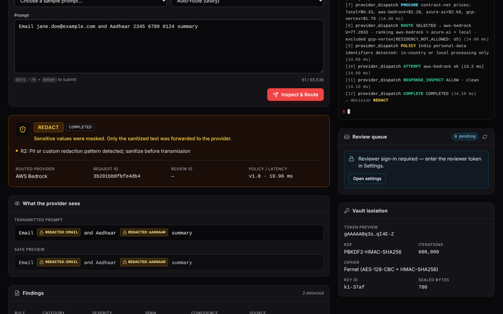

</div>

---

## 📑 Contents

1. [What is CipherMesh?](#-what-is-ciphermesh)
2. [The four decisions](#-the-four-decisions)
3. [Architecture](#-architecture)
4. [How a request flows](#-how-a-request-flows)
5. [Screenshots](#-screenshots)
6. [Tech stack](#-tech-stack)
7. [Project structure](#-project-structure)
8. [Run it on your machine](#-run-it-on-your-machine)
9. [Try it](#-try-it)
10. [API reference](#-api-reference)
11. [Configuration](#-configuration)
12. [Security design](#-security-design)
13. [Testing](#-testing)
14. [Deployment](#-deployment)
15. [Limitations](#-limitations)
16. [Author](#-author)

---

## 💡 What is CipherMesh?

Companies send prompts to AI models (AWS Bedrock, Azure AI, Google Vertex, local models) all day.
Those prompts often contain things that must **never** leave the company:

- 🔑 API keys and cloud credentials
- 📧 Customer emails, phone numbers, Aadhaar, PAN, card numbers
- 🏢 Internal URLs and confidential context

**CipherMesh sits between your app and every AI provider.** Each prompt is checked *before* it leaves.
Then CipherMesh does one of four things:

```
   Your app ──► CipherMesh ──► ✅ forward as-is
                    │       ──► ✂️ mask sensitive parts, then forward
                    │       ──► ⏸️ hold for a human to approve
                    └────── ──► ⛔ refuse, nothing is sent
```

The decision engine is an **AI agent built with LangGraph**. It runs a fixed set of steps for every prompt: inspect, seal evidence in an encrypted vault, route, call the model, and check the reply.

> **In one line:** a firewall for LLM prompts that knows the difference between a password, an email address and a harmless question.

---

## 🚦 The four decisions

| Decision | Colour | When it happens | What the provider receives | Example prompt |
|:--|:--:|:--|:--|:--|
| **ALLOW** | 🟢 Green | Nothing sensitive found | The prompt, unchanged | `Explain transformers in two lines` |
| **REDACT** | 🟠 Amber | Personal data found (email, phone, Aadhaar, PAN, card, IP) | A masked copy, e.g. `Email [REDACTED:EMAIL]` | `Email jane.doe@example.com a summary` |
| **REVIEW** | 🔵 Blue | Internal or corporate URL found | **Nothing yet.** A human must approve; approved text goes to the **local** model only | `See https://wiki.corp/runbook` |
| **BLOCK** | 🔴 Red | A secret or credential found | **Nothing.** The user is told to rotate the key | `aws_access_key_id = AKIA…` |

When several rules match, the strictest one wins: **BLOCK > REVIEW > REDACT > ALLOW**.

---

## 🏗️ Architecture

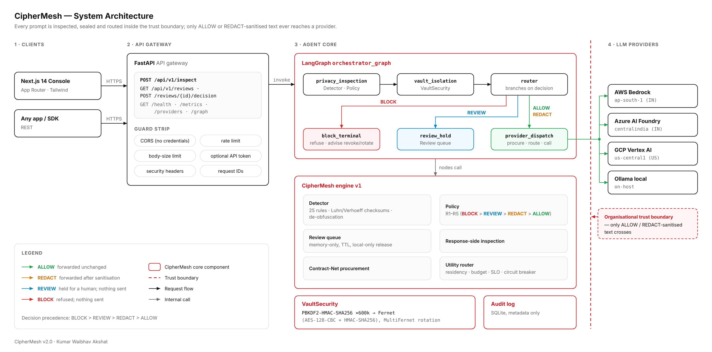

The system has four layers, read from left to right:

| # | Layer | What it does |
|:-:|:--|:--|
| 1 | **Clients** | The Next.js console, or any app calling the REST API. |
| 2 | **API gateway** (FastAPI) | Checks every request: size limit, rate limit, tokens, security headers, request IDs. |
| 3 | **Agent core** (LangGraph + CipherMesh engine) | The agent itself. It detects sensitive data, applies policy, seals evidence in the vault, picks the best provider and inspects the reply. |
| 4 | **LLM providers** | AWS Bedrock, Azure AI Foundry, GCP Vertex AI and a local Ollama model. They sit **outside** the red trust boundary. |

The **red dashed line** is the organisation's trust boundary. Only ALLOW text or REDACT-masked text ever crosses it.

### The LangGraph agent

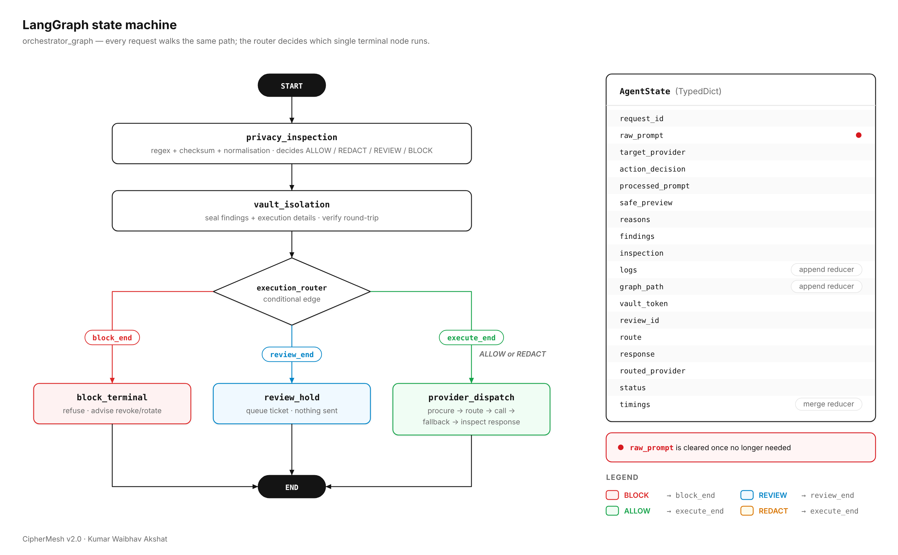

Every prompt walks the same graph:

| Step | Node | Job |
|:-:|:--|:--|
| 1 | `privacy_inspection` | Runs 25 detector rules, validates numbers with Luhn/Verhoeff checksums, decodes obfuscation (spaced text, base64, `[at]`/`[dot]`) and picks a decision. |
| 2 | `vault_isolation` | Encrypts the findings with **VaultSecurity**: PBKDF2-HMAC-SHA256 key derivation at 600,000 iterations, then Fernet encryption. It also verifies the round-trip. |
| 3 | `execution_router` | Reads the decision and chooses exactly one of three exits. |
| 4a | `block_terminal` | Refuses the request. Nothing is sent. |
| 4b | `review_hold` | Puts the prompt in the human review queue. Nothing is sent. |
| 4c | `provider_dispatch` | Negotiates a price with each provider, picks the best one with a utility score, calls it (falling back if it fails), then inspects the reply. |

The agent's memory is a typed `AgentState` (right side of the diagram). The raw prompt is wiped from it as soon as it is no longer needed.

---

## 🔁 How a request flows

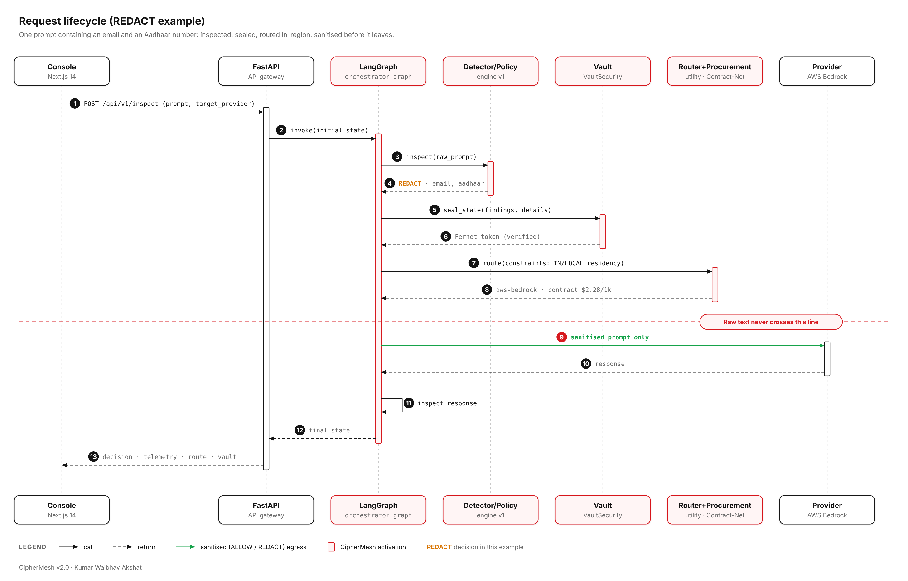

This example follows a prompt containing an **email** and an **Aadhaar number**:

1. The console sends the prompt to `POST /api/v1/inspect`.
2. FastAPI starts the LangGraph agent.
3. The detector finds the email and the Aadhaar number, so the decision is **REDACT**.
4. The vault seals the findings and returns a verified token.
5. Aadhaar is Indian personal data, so the router only allows **in-India or local** providers. It picks AWS Bedrock (Mumbai) at a negotiated price.
6. Only the **masked** prompt crosses the red line to the provider.
7. The reply is inspected too, then the console gets the decision, the trace, the route and the vault details.

---

## 📸 Screenshots

All screenshots come from the live console at [ciphermesh-console.vercel.app](https://ciphermesh-console.vercel.app).

### The four decisions

<table>
  <tr>
    <td width="50%" align="center"><b>🟢 ALLOW</b>: clean prompt forwarded unchanged</td>
    <td width="50%" align="center"><b>🟠 REDACT</b>: email and Aadhaar masked before sending</td>
  </tr>
  <tr>
    <td>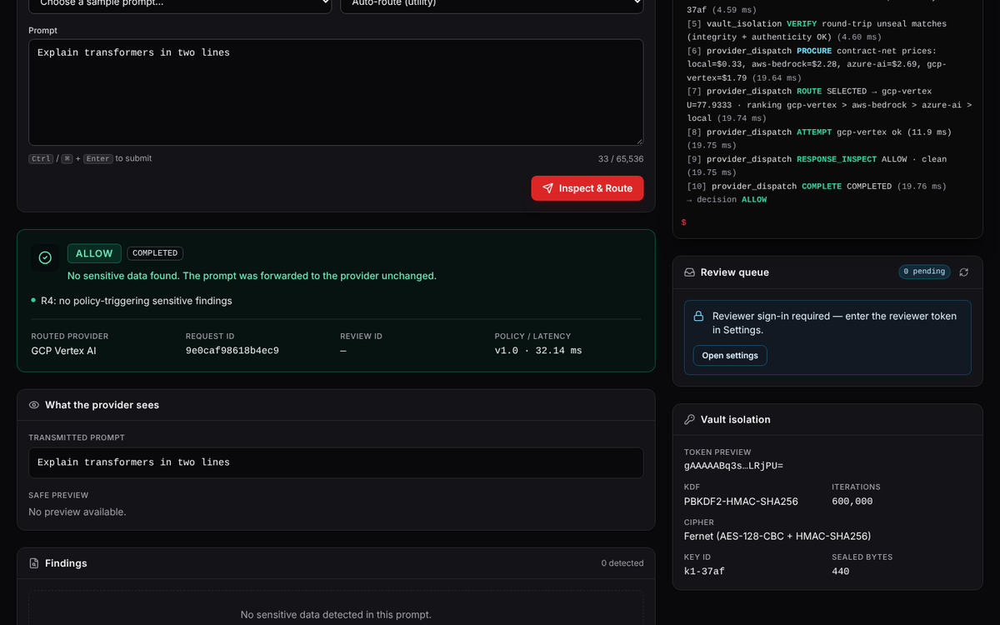</td>
    <td></td>
  </tr>
  <tr>
    <td width="50%" align="center"><b>🔵 REVIEW</b>: internal URL held for a human</td>
    <td width="50%" align="center"><b>🔴 BLOCK</b>: API key detected, nothing sent</td>
  </tr>
  <tr>
    <td>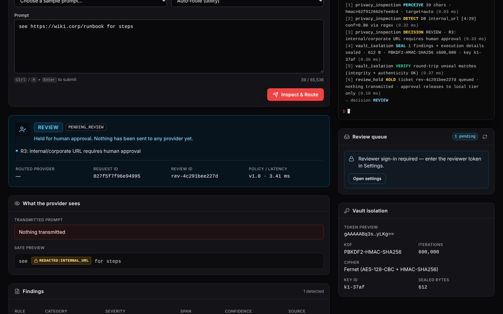</td>
    <td>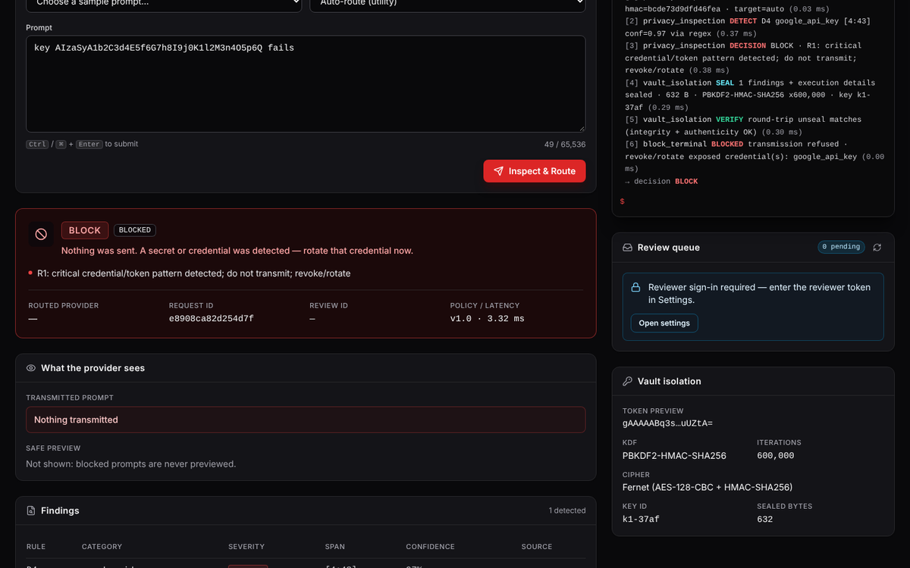</td>
  </tr>
</table>

### Human review and routing

<table>
  <tr>
    <td width="50%" align="center"><b>Review queue</b>: approve or deny with the reviewer token</td>
    <td width="50%" align="center"><b>After approval</b>: released to the local model only</td>
  </tr>
  <tr>
    <td>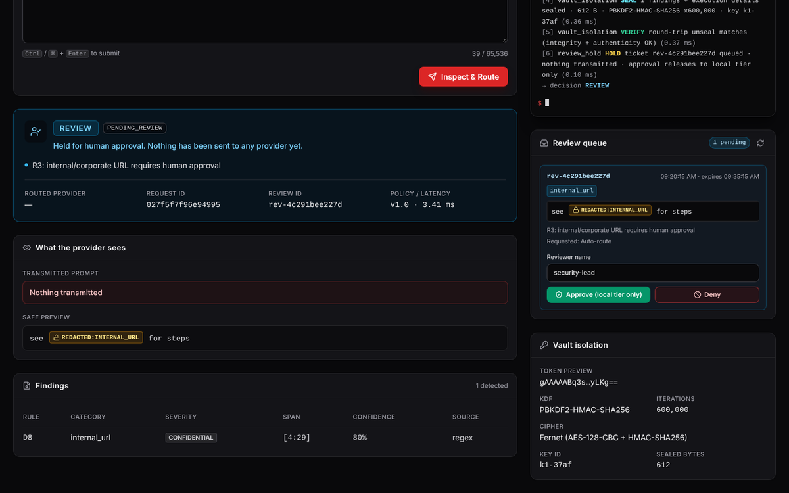</td>
    <td>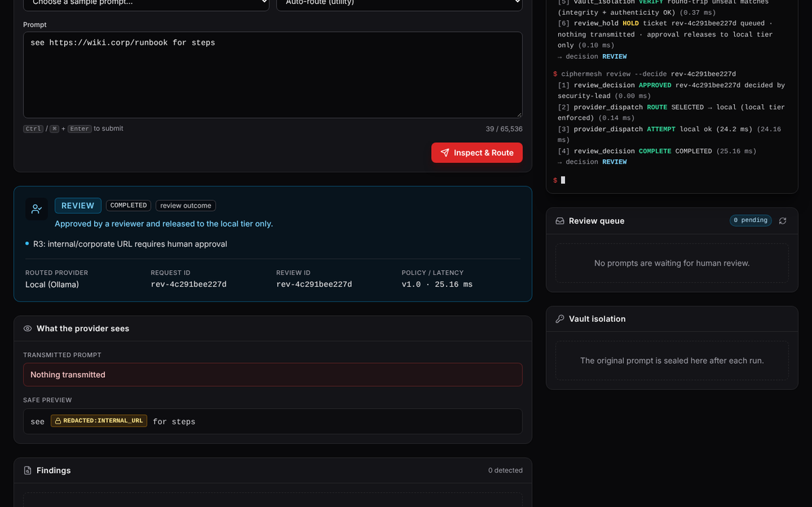</td>
  </tr>
  <tr>
    <td width="50%" align="center"><b>Utility routing</b>: provider scores, negotiated prices, residency rule</td>
    <td width="50%" align="center"><b>Architecture page</b>: diagrams and the live LangGraph definition</td>
  </tr>
  <tr>
    <td>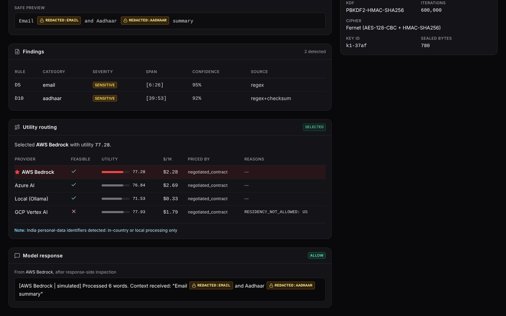</td>
    <td>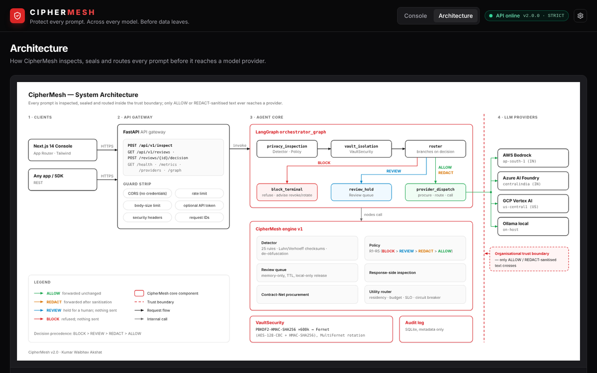</td>
  </tr>
</table>

### Mobile (390 px)

<p align="center">
  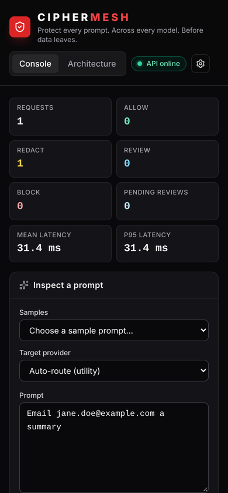
  &nbsp;
  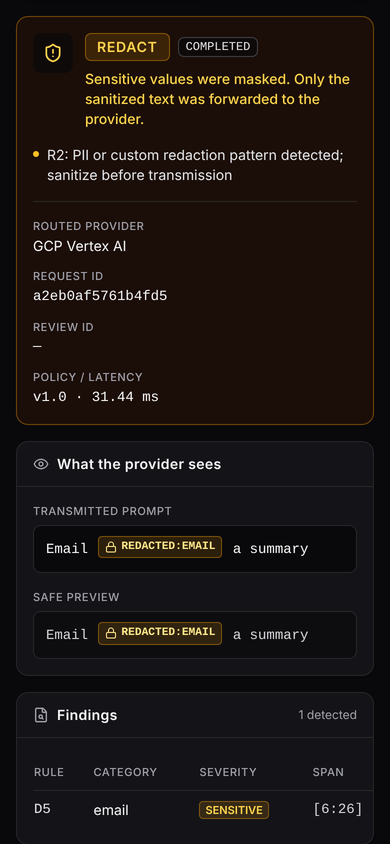
  &nbsp;
  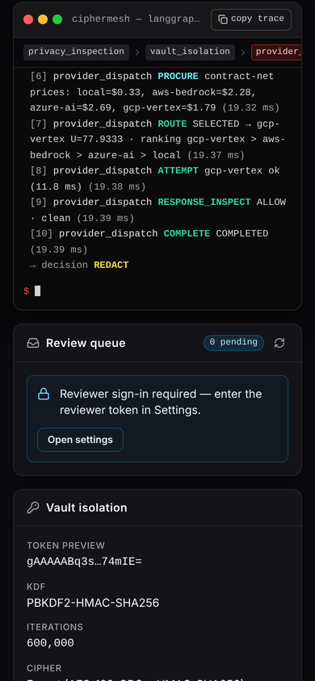
</p>

### What each panel shows

| Panel | What you see |
|:--|:--|
| **Decision card** | The colour-coded outcome, its status and the policy rule that fired (R1–R5) |
| **What the provider sees** | The exact text that left the trust boundary, or "Nothing transmitted" |
| **Findings** | Each detected item with its rule, severity, position and confidence |
| **Utility routing** | Every provider's score and negotiated price, and why any were excluded |
| **Terminal** | A live trace of every LangGraph step with timings |
| **Review queue** | Held prompts with Approve / Deny (needs the reviewer token) |
| **Vault isolation** | Encryption details of the sealed evidence |

---

## 🧰 Tech stack

| Area | Technology |
|:--|:--|
| Agent orchestration | **LangGraph** 1.2: `StateGraph`, typed state, conditional edges |
| API | **FastAPI** 0.162, Pydantic 2, Uvicorn |
| Encryption | `cryptography`: PBKDF2-HMAC-SHA256 + Fernet (AES-128-CBC + HMAC-SHA256), MultiFernet key rotation |
| Detection engine | CipherMesh engine v1: regex + checksums + normalisation, policy R1–R5, Contract-Net negotiation, utility router |
| Frontend | **Next.js 14** (App Router), React 18, TypeScript (strict), **Tailwind CSS**, lucide icons |
| Testing | pytest (161 tests), ESLint, `tsc`, Playwright end-to-end checks |
| Delivery | Docker, docker-compose, GitHub Actions CI, Vercel |

---

## 🗂️ Project structure

```text
cipher_mesh_agent/
├── backend/                     ← Python API + AI agent
│   ├── app/
│   │   ├── agents/
│   │   │   ├── graph.py         ← LangGraph agent (AgentState, nodes, router)
│   │   │   └── services.py      ← shared engine, vault and metrics
│   │   ├── core/
│   │   │   ├── security.py      ← VaultSecurity (PBKDF2 + Fernet)
│   │   │   └── config.py        ← settings read from environment variables
│   │   ├── api/
│   │   │   ├── routes.py        ← REST endpoints
│   │   │   ├── schemas.py       ← request/response models
│   │   │   └── deps.py          ← tokens and rate limiting
│   │   └── main.py              ← FastAPI app, CORS, security middleware
│   ├── ciphermesh/              ← detection, policy, review, negotiation, routing engine
│   ├── tests/                   ← 161 automated tests
│   ├── api/index.py             ← Vercel entry point
│   ├── requirements.txt
│   └── Dockerfile
├── frontend/                    ← Next.js console
│   ├── app/
│   │   ├── page.tsx             ← main console
│   │   ├── architecture/        ← architecture page
│   │   └── components/          ← decision card, terminal, review queue, …
│   ├── lib/api.ts               ← typed API client
│   ├── package.json
│   └── Dockerfile
├── docs/
│   ├── API_CONTRACT.md          ← full API specification
│   ├── AUDIT.md                 ← independent audit findings and fixes
│   ├── diagrams/                ← architecture, LangGraph flow, sequence (SVG + PNG)
│   └── screenshots/
├── docker-compose.yml           ← run everything with one command
└── .github/workflows/ci.yml     ← automatic tests on every push
```

---

## 🚀 Run it on your machine

### Prerequisites

| Tool | Version | Check with |
|:--|:--|:--|
| Python | 3.12 or newer | `python --version` |
| Node.js | 20 or newer | `node --version` |
| Git | any | `git --version` |
| Docker *(optional)* | any | `docker --version` |

### Option A: Docker (one command)

```bash
git clone https://github.com/kumarwaibhav/CipherMesh.git
cd CipherMesh
docker compose up --build
```

Then open **http://localhost:3000**. The API runs on http://localhost:8000.

### Option B: Run each part yourself

**1. Start the backend** in terminal 1:

```bash
cd backend
python -m venv .venv
# Windows:      .venv\Scripts\activate
# macOS/Linux:  source .venv/bin/activate
pip install -r requirements-dev.txt
uvicorn app.main:app --reload
```

Check it at **http://127.0.0.1:8000/docs**. You should see the interactive API page.

**2. Start the frontend** in terminal 2:

```bash
cd frontend
npm ci
# Windows PowerShell:  copy .env.example .env.local
# macOS/Linux:         cp .env.example .env.local
npm run dev
```

Open **http://localhost:3000**. The pill at the top right should read **API online**.

> 💡 Locally the review queue is open (development mode), so no reviewer token is needed.

---

## 🧪 Try it

In the console, pick a prompt from **Samples** and press **Inspect & Route**. You can also call the API directly:

```bash
curl -X POST https://ciphermesh-api.vercel.app/api/v1/inspect \
  -H "Content-Type: application/json" \
  -d '{"prompt": "Email jane.doe@example.com and Aadhaar 2345 6789 0124", "target_provider": "auto"}'
```

The response, shortened:

```json
{
  "action_decision": "REDACT",
  "status": "COMPLETED",
  "processed_prompt": "Email [REDACTED:EMAIL] and Aadhaar [REDACTED:AADHAAR]",
  "routed_provider": "aws-bedrock",
  "graph_path": ["privacy_inspection", "vault_isolation", "provider_dispatch"],
  "vault": { "kdf": "PBKDF2-HMAC-SHA256", "iterations": 600000, "cipher": "Fernet (AES-128-CBC + HMAC-SHA256)" }
}
```

---

## 📡 API reference

Base URL: `https://ciphermesh-api.vercel.app`. The full contract is in [`docs/API_CONTRACT.md`](docs/API_CONTRACT.md).

| Method | Endpoint | What it does | Auth |
|:--|:--|:--|:--|
| `POST` | `/api/v1/inspect` | Runs the agent on a prompt | Optional API token |
| `GET` | `/api/v1/reviews?status=PENDING` | Lists held prompts | Reviewer token |
| `POST` | `/api/v1/reviews/{id}/decision` | Approves or denies a held prompt | Reviewer token |
| `GET` | `/api/v1/health` | Service status | — |
| `GET` | `/api/v1/metrics` | Decision counts and latency | — |
| `GET` | `/api/v1/providers` | Providers with negotiated prices | — |
| `GET` | `/api/v1/graph` | Live LangGraph definition (Mermaid) | — |

**Error codes:**

| Code | Meaning |
|:--|:--|
| 401 | Missing or wrong token |
| 403 | Review console disabled on this deployment |
| 404 | Unknown or expired review |
| 409 | Review already decided |
| 413 | Body too large |
| 422 | Invalid input (your prompt is never echoed back) |
| 429 | Rate limited |

---

## ⚙️ Configuration

The backend reads environment variables. Copy `backend/.env.example` to start.

| Variable | Default | Purpose |
|:--|:--|:--|
| `CIPHERMESH_ENV` | `development` | Set to `production` to enforce the secrets below |
| `CIPHERMESH_VAULT_SEED` | — | Master secret for the vault (≥ 32 random chars, **required in production**) |
| `CIPHERMESH_VAULT_SALT` | — | Per-deployment salt (**required in production**) |
| `CIPHERMESH_REVIEW_TOKEN` | — | Reviewer password; without it, production disables the review queue |
| `CIPHERMESH_API_TOKEN` | — | Optional: require a token to call `/inspect` |
| `CIPHERMESH_CORS_ORIGINS` | `*` | Allowed browser origins (comma-separated) |
| `CIPHERMESH_RATE_LIMIT_PER_MIN` | `120` | Requests per minute per client (`0` turns it off) |
| `CIPHERMESH_MAX_BODY_BYTES` | `400000` | Largest accepted request |
| `CIPHERMESH_VAULT_ITERATIONS` | `600000` | PBKDF2 iterations (minimum 100,000) |
| `CIPHERMESH_VAULT_PREVIOUS_SEEDS` | — | Old seeds kept readable during key rotation |
| `CIPHERMESH_REVIEW_TTL_S` | `900` | Seconds a held prompt waits before it expires |
| `CIPHERMESH_LATENCY_SCALE` | `0.02` | Speed of the simulated providers |
| `CIPHERMESH_OLLAMA` | `0` | `1` sends approved/local traffic to a real Ollama model |

Generate a strong seed with:

```bash
python -c "import secrets; print(secrets.token_urlsafe(48))"
```

The frontend needs one variable: `NEXT_PUBLIC_API_BASE_URL`, the backend URL. It is baked in at build time.

---

## 🔐 Security design

| Protection | How |
|:--|:--|
| Secrets never leave | BLOCK sends nothing and returns no preview, not even a partial one |
| Encrypted evidence | Findings are sealed with Fernet; each token is stored in a metadata-only audit log |
| No plain hashes | Telemetry uses a keyed HMAC fingerprint, not SHA-256 of the prompt |
| Human-in-the-loop | Review needs a separate reviewer token; approved text goes to the local model only and is re-inspected first |
| Response checking | Model replies are scanned too; leaked secrets are withheld |
| Abuse limits | A streamed body-size cap (beats chunked uploads), a rate limit on every route, request-ID sanitisation |
| Browser safety | CSP, HSTS, `nosniff`, `frame-ancestors 'none'`, CORS without credentials |
| No echo | Validation errors never repeat what you sent |

Two independent reviewers audited the code: one for backend security, one for frontend quality and accessibility. Every finding and its fix is in [`docs/AUDIT.md`](docs/AUDIT.md).

---

## ✅ Testing

```bash
cd backend  && python -m pytest          # 161 tests
cd frontend && npm run lint && npm run typecheck && npm run build
```

GitHub Actions runs the same checks on every push (`.github/workflows/ci.yml`).

---

## ☁️ Deployment

The live demo runs on **Vercel** as two projects.

| Project | Root folder | Framework | Environment variables |
|:--|:--|:--|:--|
| API | `backend` | Other (Python) | `CIPHERMESH_ENV=production`, `CIPHERMESH_VAULT_SEED`, `CIPHERMESH_VAULT_SALT`, `CIPHERMESH_REVIEW_TOKEN` |
| Console | `frontend` | Next.js | `NEXT_PUBLIC_API_BASE_URL=<your API URL>` |

`backend/vercel.json` already routes every request to the FastAPI app. For servers or Kubernetes, use the two Dockerfiles or `docker-compose.yml`.

---

## ⚠️ Limitations

- **Simulated cloud providers.** Bedrock, Azure and Vertex are realistic simulations, so the demo costs nothing. Prices and latencies are illustrative. Local Ollama can be real (`CIPHERMESH_OLLAMA=1`).
- **Serverless memory.** On Vercel, the review queue and metrics live in each running instance. A restart clears them. The Docker deployment keeps them for the life of the process. For many instances, back the queue with Redis or Postgres.
- **Reviewer identity.** The reviewer token proves the caller *may* review. Per-person identity and "submitter ≠ approver" checks would need a login provider.

---

## 👤 Author

**Kumar Waibhav Akshat**
21CSE525T Agent Technology · SRM Institute of Science and Technology
